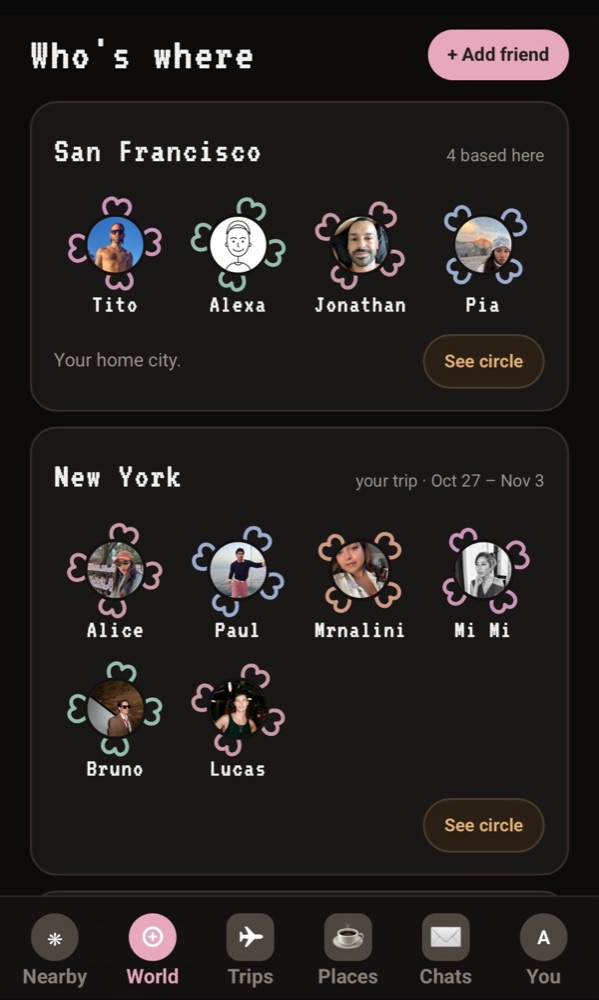
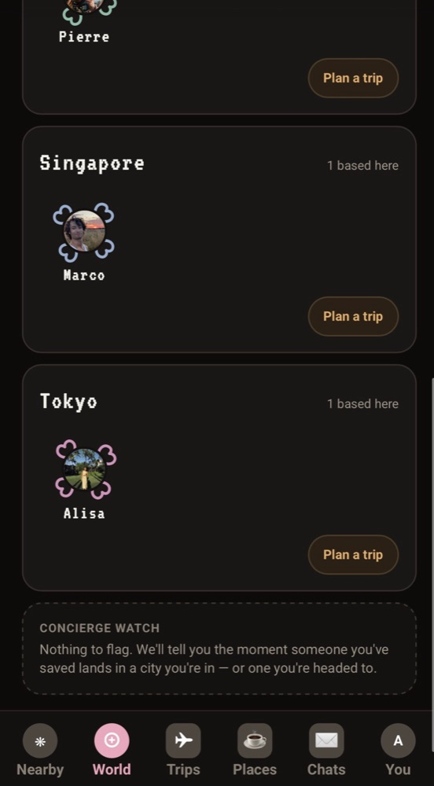
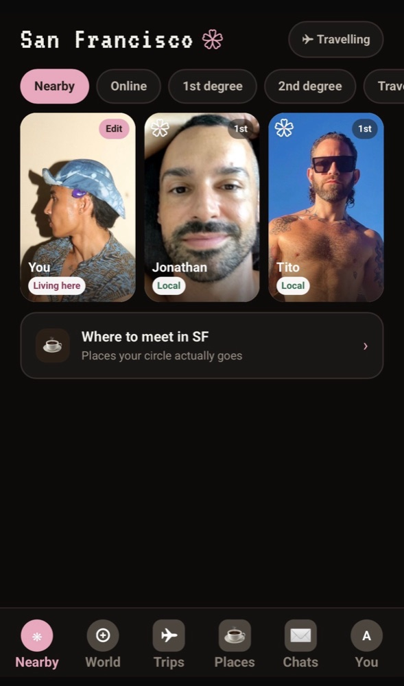
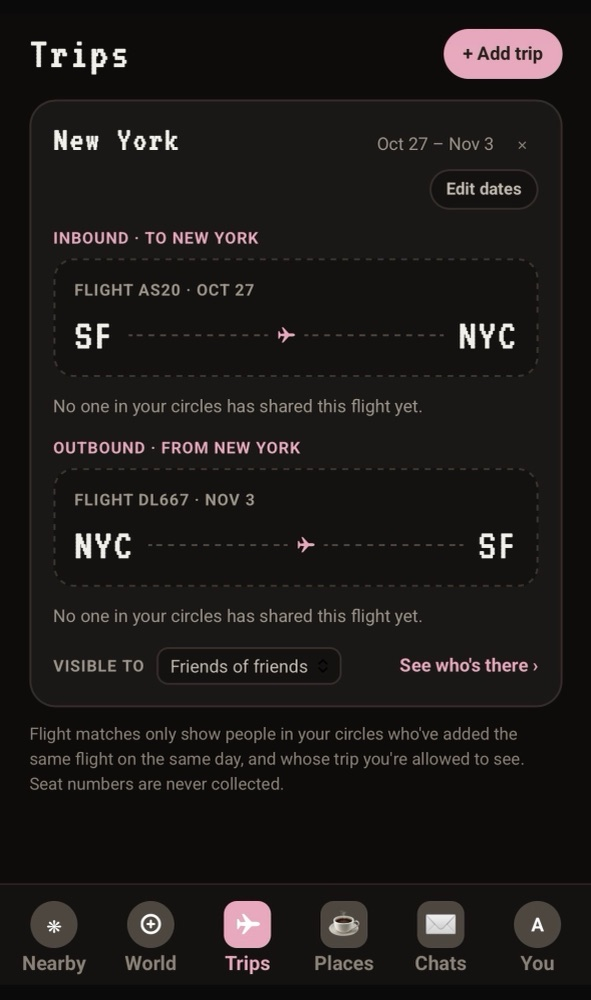
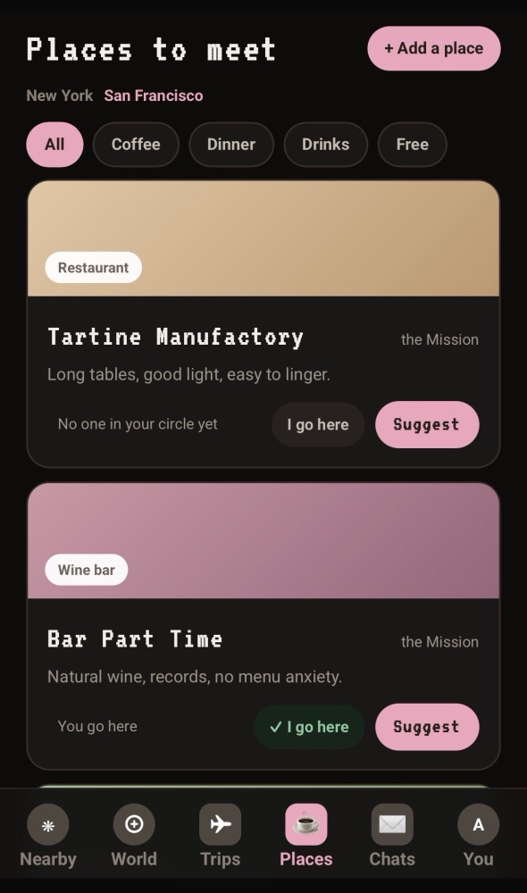
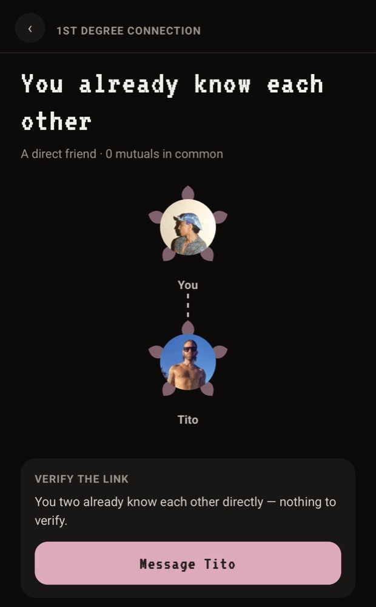
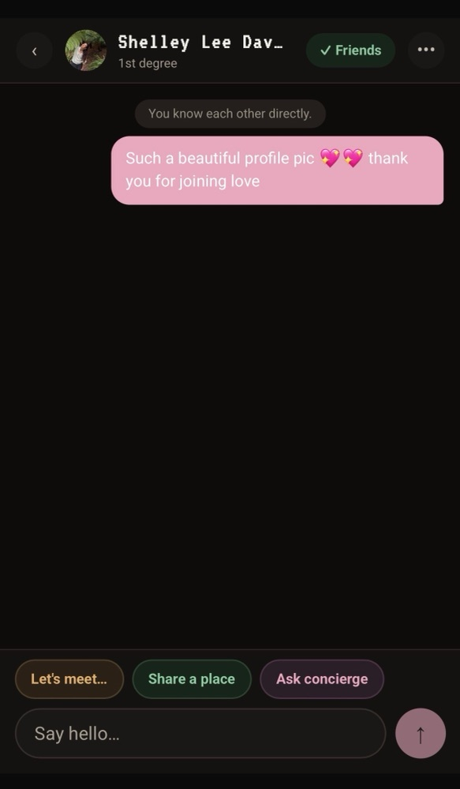
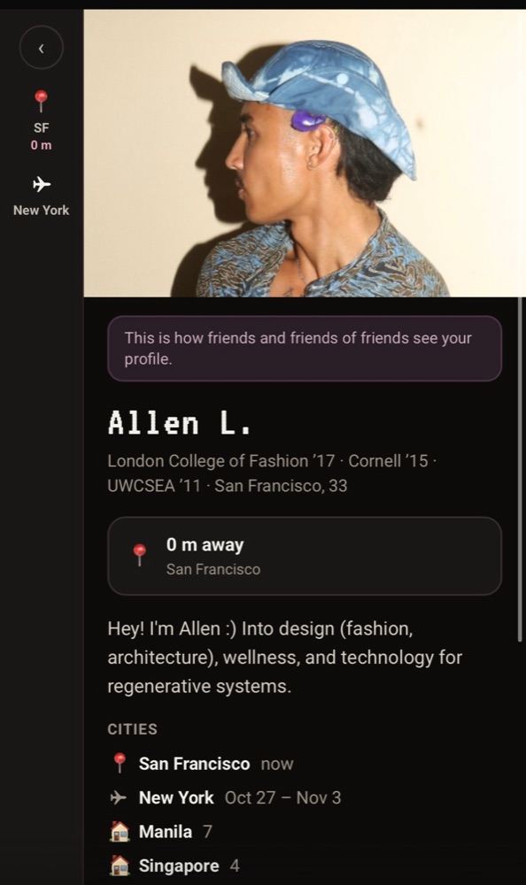

# Friend Flower: build log

A public case study of how I built and shipped **Friend Flower** with Claude Code.

Friend Flower is a mobile web app for meeting friends of friends wherever you are. The source repo is private, so this repo shows how I work: what shipped, how I used Claude Code, how I verified the output, and a few small code excerpts.

<!-- TODO(Allen): add live app link / TestFlight / demo video link here -->

## The product in one paragraph

You see which of your friends, and friends of friends, are in your city or are about to be. You can say hi, verify a mutual friend, and find a time to meet. Privacy is the main constraint. Knowing someone's phone number must never reveal where they are, so every read of another person goes through a database function that checks your connection to them first.

## At a glance

| | |
|---|---|
| Stack | Next.js 16 (App Router) · React 19 · Tailwind 4 · Supabase (Postgres, Auth, Realtime, Storage) · Vercel |
| Built with | Claude Code, with Supabase connected over MCP |
| Timeline | First commit 2026-09-25, latest 2026-10-09 (36 commits in 15 days) |
| Database | 14 SQL migrations, 50+ Postgres functions holding the privacy and friend-graph rules |
| Tests | 7 scenario test files (about 1,000 lines) that run the real migrations in in-memory Postgres |

## The app

<table>
  <tr>
    <td align="center"> World: who's where</td>
    <td align="center"> Concierge watch</td>
    <td align="center"> Nearby, by degree</td>
    <td align="center"> Trips, with who can see them</td>
  </tr>
  <tr>
    <td align="center"> Places to meet</td>
    <td align="center"> Connection and verification</td>
    <td align="center"> Chat actions</td>
    <td align="center"> Profile, as others see it</td>
  </tr>
</table>

## What's in this repo

| Path | What you'll find |
|---|---|
| [`docs/timeline.md`](docs/timeline.md) | What shipped, day by day, from the real git history |
| [`docs/how-i-work-with-claude-code.md`](docs/how-i-work-with-claude-code.md) | My workflow: guardrails, verification, how I split work |
| [`docs/architecture.md`](docs/architecture.md) | System diagram and the key design decisions |
| [`docs/case-studies/01-concierge-watch-and-meet-times.md`](docs/case-studies/01-concierge-watch-and-meet-times.md) | A full feature, from idea to merged PR: schema, privacy rules, UI, tests |
| [`docs/case-studies/02-world-grid-iteration.md`](docs/case-studies/02-world-grid-iteration.md) | Two small UI PRs back to back: fast iteration with Claude Code |
| [`excerpts/db-test-harness/`](excerpts/db-test-harness) | The test harness and one real scenario test file |
| [`excerpts/world-grid/`](excerpts/world-grid) | The actual diff from the World screen iteration |
| [`claude-setup/`](claude-setup) | How Claude Code is configured for the project |

## Why the repo is shaped this way

The full source stays private. I kept only things that show process (timeline, decisions, tests, diffs) and left out the product's schema, copy and secrets.

All code here is shown for review. Please don't reuse it.

## Contact

Allen Navasero · allen.navasero@gmail.com
