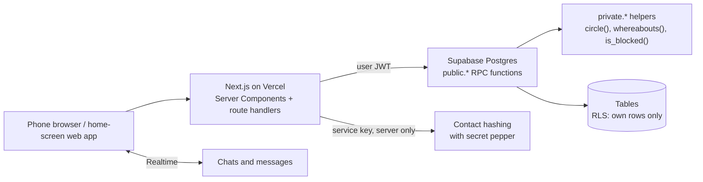

# Architecture

## Decisions that shaped the build

**1. Privacy lives in the database, not the UI.**
Tables only return your own rows. Anything about another person comes from a `security definer` function that checks your connection degree first, so a UI bug can't leak a neighbourhood. Functions run with `set search_path = ''` and are written with schema-qualified names.

**2. Knowing a number never reveals a location.**
Contacts are hashed on the server with a secret pepper, and raw numbers and emails are never stored. If only one side has the other's number, they get an "Add friend" suggestion and nothing more.

**3. New feature tables are closed by default.**
For the meet-times feature, the new tables have all privileges revoked from `anon` and `authenticated`. The only way in is through functions, so there is no way to read picks from chats you aren't in.

**4. The Concierge is computed, not stored.**
Concierge watch works out overlaps from trips and home cities at read time. It always follows the current privacy rules, and there's no copy of someone's location to go stale or leak.

**5. Tests run the real migrations.**
Tests apply every migration, in order, to an in-memory Postgres (PGlite) with Supabase's `auth` and `storage` schemas stubbed. There's no cloud account or network, and the tests exercise the same SQL that ships. See [`excerpts/db-test-harness`](../excerpts/db-test-harness).

**6. Guarding against stale framework knowledge.**
The project's `AGENTS.md` warns the model that this Next.js version has breaking changes and tells it to read the bundled docs in `node_modules/next/dist/docs/` before writing code. That keeps Claude from writing against stale framework knowledge.
